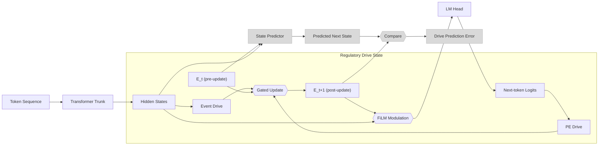

# RDA — Regulatory Drive Architecture

An experimental extension of [nanochat](https://github.com/karpathy/nanochat) that gives a
small language model a persistent internal state built from a handful of primitive
**regulatory drives**, and conditions the transformer on it.

This is a fork of Karpathy's **nanochat** — the simplest experimental harness for training
LLMs, designed to run on a single GPU node with minimal, hackable code. Everything in this
repo about tokenization, pretraining, evaluation and the model/inference stack is nanochat's
and is credited to [karpathy/nanochat](https://github.com/karpathy/nanochat). The RDA work is
an addition on top of that base. The original FineWeb-Edu baseline is preserved at tag
`baseline-fineweb-edu-208m` for comparison against trained runs.

## The idea

Most attempts to give a language model something like emotion or affect either hand-label a
taxonomy of feelings and train the model to predict those labels, or bolt on a fixed prompt
and hope the right thing emerges. RDA takes a different, more primitive route.

The model carries an 8-dimensional state vector across the sequence:

| drive | rough reading |
|---|---|
| `novelty` | how much this differs from what came before |
| `uncertainty` | how poorly the current context is pinned down |
| `threat` | how much this looks like something that should be avoided |
| `integrity` | how consistent this is with what was established earlier |
| `agency` | how much causal control the context asserts |
| `learning_progress` | how much the model is actually learning from this |
| `arousal` | general intensity / activation level |
| `homeostatic_dev` | drift away from the model's settled baseline |

These are deliberately **not** named emotions. They are the kind of coarse, cheap signals
that a nervous system might plausibly maintain with almost no machinery — the question being
whether anything higher-level and more recognisable can fall out of primitive drives plus
experience, rather than being asserted in advance by whoever wrote the label set.

The state is a small recurrent process. At each position the model computes an event term
from a normalised pre-outcome hidden state and a prediction-error term from the current
token-level loss, combines them, and relaxes the state toward the result:

```
E_{t+1} = decay * E_t + (1 - decay) * tanh(0.1 * event_proj(LayerNorm(h_t)) + pe_proj(pe_t))
```

The state then conditions the model through **FiLM modulation** of the residual stream, so it
affects the forward pass rather than merely observing it.

## Current status

Implemented and trained:

- **Baseline** — the unmodified nanochat path, unchanged and still the control.
- **Persistent state** — an 8-dim drive vector carried across a sequence with decay-only
  persistence (never hard-reset at a document boundary).
- **FiLM conditioning** — the state modulates the residual stream, so the architecture
  actually changes the model's computation rather than just watching it.

Implemented but not yet wired into learning:

- **State prediction error** — the model predicts its *next* drive state from the current
  state plus a pre-outcome hidden state, and the difference is computed and logged as `dpe`.
  Nothing consumes it yet, so the predictor receives no gradient. This is the next thing to
  build.

Not started:

- **Salience-weighted memory** — storage and retrieval weighted by the drive state.

### Results so far

All numbers below are val BPB at step 600 for a depth-8, 768-wide model trained
600 steps on FineWeb-Edu (~19.7M tokens), using the same flags for every run
(`--depth=8 --aspect-ratio=96 --head-dim=128 --max-seq-len=1024
--window-pattern=L --device-batch-size=4 --total-batch-size=32768
--eval-every=50 --eval-tokens=524288`).

**Baseline (A), three seeds:**

| seed | val BPB |
|---|---|
| 42 | 1.301217 |
| 43 | 1.287544 |
| 44 | 1.295109 |

mean **1.294623**, spread (max−min) **0.0137**, std ≈ 0.0069.

**The earlier RDA run: 1.286248 — a single seed, and it was leaky.** That
number was produced by a model whose FiLM pathway had two temporal leaks (the
state at position 0 was computed from the last token, and the PE pathway gave
every position a one-token lookahead). Both are fixed in `539007e`; the
per-position causal FiLM replaced them. More importantly, **1.286248 falls
inside A's own seed range** (1.287544–1.301217), i.e. it is not distinguishable
from a baseline draw. The old comparison that reported this as an improvement
used a single seed on each side.

**RDA does not currently beat the baseline.** An earlier version of this
README claimed it was "a better language model on this measure". That claim is
withdrawn: it rested on a single-seed comparison whose margin is smaller than
the seed-to-seed spread of the control.

**Causal-FiLM B′ has no result yet.** The first B′ attempt aborted at step ~10
under the saturation rule: the `threat` drive crossed |E| > 0.98 and stayed
there, meaning the tanh had stopped responding and no later loss number would
have been attributable to the drive. Fixing that is the current work.

**The recall harness results are single-seed and not conclusive.** The
per-group differences between A and the old B are small relative to their
per-document variance, and both were single runs. Treat them as a signal to
re-test with multiple seeds, not as a finding. The harness has not been re-run
against the causal-FiLM model.

There is also a structural caveat worth knowing before drawing conclusions from the state
trajectories: `update()` runs once per token position within a single forward pass, so the
state relaxes geometrically along *position* and the trajectory is largely a function of how
much context has accumulated. Content sensitivity is real but much smaller than the
positional ramp. Diagnostic tooling for this lives in `diagnostics/diagnose_saturation.py`.

## Usage

Training with RDA (add `--rda` to any normal nanochat pretraining invocation):

```bash
python -m scripts.base_train --model-tag=model-b-rival --rda \
  --depth=8 --aspect-ratio=96 --head-dim=128 --max-seq-len=1024 \
  --window-pattern=L --device-batch-size=4 --total-batch-size=32768 \
  --num-iterations=600 --eval-every=50 --eval-tokens=524288 \
  --core-metric-every=-1 --sample-every=-1
```

Omitting `--rda` runs the untouched nanochat path.

| flag | meaning |
|---|---|
| `--rda` | enable the RDA module |
| `--rda-debug-steps` | how many steps to log drive-state norms (default 200) |
| `--rda-drive-wd` | weight decay on the drive projections (default 0.01) |

The old `--primal-state`, `--primal-debug-steps` and `--primal-drive-wd` names still parse as
deprecated aliases and warn.

### Demo

`demo/run_demo.py` loads a trained checkpoint read-only and prints the per-token drive-state
trajectory with per-token surprisal, plus a comparison of the settled final state against a
fixed neutral-paragraph reference. Runs on CPU by default so it never reserves the training
GPU:

```bash
python demo/run_demo.py --example 1     # built-in examples
python demo/run_demo.py --text "..."    # one-off
python demo/run_demo.py                 # interactive loop
```

### Evaluation

```bash
python eval/compare_recall.py                   # anomaly-recall comparison vs baseline
python diagnostics/smoke_rda.py                 # optimizer-coverage / gradient smoke test
python diagnostics/check_mermaid.py             # validate the diagram in this file
```

## Credits

nanochat is the work of [Andrej Karpathy](https://github.com/karpathy) and contributors;
see [karpathy/nanochat](https://github.com/karpathy/nanochat). This fork exists to experiment
on top of it, and the RDA additions are not part of nanochat.

---

## Architecture



**DPE is a dead end.** `Drive Prediction Error` (grey) is computed and logged, but nothing
consumes it — it is not an input to the LM head, the loss, or the next state. `Drive
Prediction Error` terminates there deliberately; the grey fill marks the whole
prediction-error pathway as implemented-but-unused.

**ET_PRE vs ET_POST.** The predictor is given the state *before* this step's update
(`E_t`) plus the pre-outcome hidden state; the comparison then pits its forecast against the
state *after* the update (`E_t+1`). Conflating them would imply the predictor sees the
value it is being scored against.

**FiLM is applied per position,** each with the causal state for that position: position 0
is modulated by the state entering the sequence, and position `p` by the state as it stood
after position `p-1` was consumed. No position is ever modulated by a state derived from a
later token. The earlier implementation applied FiLM once, after the loop, using the final
state — which meant position 0 was modulated by a state computed from the last token, a
1022-token lookahead at T=1024, and made the architecture impossible to reproduce during
autoregressive decoding.

Reading it left to right:

- **Token sequence → Transformer trunk → Hidden states.** The RDA module reads the
  pre-outcome hidden state at each position; it does not modify the trunk.
- **PE Drive** takes the token-level prediction error, which comes from the logits, not
  from the hidden state. **Event Drive** takes the normalised hidden state. Both feed the
  **Gated Update**, which mixes the incoming `E_t` with the new drive —
  `E_{t+1} = decay·E_t + (1-decay)·tanh(·)`.
- **FiLM Modulation** is the only path by which the state affects the model. Each position is
  modulated by the causal state for that position, then the residual stream feeds the
  **LM Head** to produce next-token logits. During generation the state is threaded through
  the KV-cache decode steps, so single-token decoding continues the same recurrence
  training established.
- **Prediction-Error Pathway (grey, not yet consumed).** The state predictor tries to
  forecast the next drive state, and the **Drive Prediction Error** is the difference. It
  is computed and logged, but nothing consumes it — so the predictor currently receives no
  gradient. This is the next thing to wire up.

The same diagram lives in [`dev/rda_architecture.mmd`](dev/rda_architecture.mmd) if you want
to render it elsewhere. `diagnostics/check_mermaid.py` validates the block in this file and
re-syncs
the `.mmd` from it, so the two cannot drift.

## Layout

| path | what |
|---|---|
| `nanochat/rda.py` | the RDA module, predictor, and model wrapper |
| `scripts/base_train.py` | nanochat pretraining, with `--rda` opt-in wiring |
| `demo/run_demo.py` | read-only interactive demo |
| `eval/compare_recall.py` | anomaly-recall A/B harness |
| `eval/build_anomaly_set.py` | synthetic anomaly set generator |
| `diagnostics/smoke_rda.py` | optimizer coverage + gradient smoke test |
| `diagnostics/smoke_saturation.py` | drive-saturation gate, 30/60-step |
| `diagnostics/diagnose_saturation.py` | 200-step tripwire + fixed-point gap analysis |
| `diagnostics/probe_drives.py` | separates the event and prediction-error drive terms |
| `diagnostics/check_hnorm.py` | LayerNorm scale-invariance check |
| `diagnostics/analyze_loss_slope.py` | loss-vs-saturation analysis |
| `diagnostics/diagnose_film_causality.py` | measures FiLM positional causality |
| `diagnostics/checkpoint_roundtrip.py` | trains briefly and saves a probe checkpoint |
| `diagnostics/checkpoint_roundtrip_verify.py` | reloads it in a fresh process, value-exact |

Generated outputs are **not** in git — they are reproducible and were
committing to the repo by accident:

| path | what | regenerate with |
|---|---|---|
| `logs/*.log` | training / eval stdout captures | any `base_train.py` run |
| `eval/eval_anomaly_set.jsonl` | synthetic anomaly set (~5.5 MB) | `python eval/build_anomaly_set.py` |
| `eval/recall_comparison.json` | recall A/B results | `python eval/compare_recall.py` |
| `base_checkpoints/` | model weights | `python scripts/base_train.py` |

`eval/build_anomaly_set.py` writes its output to `eval/`, and
`compare_recall.py` reads it from there, so the two stay consistent even
though the file is untracked.

### Verifying a checkpoint actually loads

Shape-matching a state dict does not prove a checkpoint was applied. A
checkpoint that is read but never handed to `load_state_dict` leaves the
model at random init while every shape check still passes — that bug
silently invalidated an entire round of recall numbers once already. The
round-trip pair checks values against the file on disk instead, and asserts
the pre-load value *differs* so the test cannot pass vacuously:

```bash
python diagnostics/checkpoint_roundtrip.py        # train 20 steps, save
python diagnostics/checkpoint_roundtrip_verify.py # fresh process, exact compare
```
