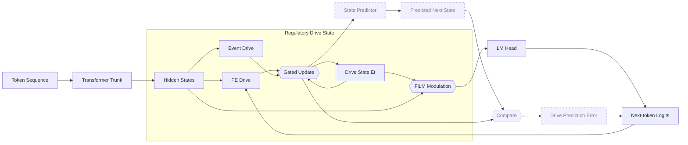

# RDA — Regulatory Drive Architecture

An experimental extension of [nanochat](https://github.com/karpathy/nanochat) that gives a
small language model a persistent internal state built from a handful of primitive
**regulatory drives**, and conditions the transformer on it.

This is a fork of Karpathy's **nanochat** — the simplest experimental harness for training
LLMs, designed to run on a single GPU node with minimal, hackable code. Everything in this
repo about tokenization, pretraining, evaluation and the model/inference stack is nanochat's
and is credited to [karpathy/nanochat](https://github.com/karpathy/nanochat). The RDA work is
an addition on top of that base. The original FineWeb-Edu baseline is preserved at tag
`baseline-fineweb-edu-208m` for comparison against trained runs.

## The idea

Most attempts to give a language model something like emotion or affect either hand-label a
taxonomy of feelings and train the model to predict those labels, or bolt on a fixed prompt
and hope the right thing emerges. RDA takes a different, more primitive route.

The model carries an 8-dimensional state vector across the sequence:

| drive | rough reading |
|---|---|
| `novelty` | how much this differs from what came before |
| `uncertainty` | how poorly the current context is pinned down |
| `threat` | how much this looks like something that should be avoided |
| `integrity` | how consistent this is with what was established earlier |
| `agency` | how much causal control the context asserts |
| `learning_progress` | how much the model is actually learning from this |
| `arousal` | general intensity / activation level |
| `homeostatic_dev` | drift away from the model's settled baseline |

These are deliberately **not** named emotions. They are the kind of coarse, cheap signals
that a nervous system might plausibly maintain with almost no machinery — the question being
whether anything higher-level and more recognisable can fall out of primitive drives plus
experience, rather than being asserted in advance by whoever wrote the label set.

The state is a small recurrent process. At each position the model computes an event term
from a normalised pre-outcome hidden state and a prediction-error term from the current
token-level loss, combines them, and relaxes the state toward the result:

```
E_{t+1} = decay * E_t + (1 - decay) * tanh(0.1 * event_proj(LayerNorm(h_t)) + pe_proj(pe_t))
```

The state then conditions the model through **FiLM modulation** of the residual stream, so it
affects the forward pass rather than merely observing it.

## Current status

Implemented and trained:

- **Baseline** — the unmodified nanochat path, unchanged and still the control.
- **Persistent state** — an 8-dim drive vector carried across a sequence with decay-only
  persistence (never hard-reset at a document boundary).
- **FiLM conditioning** — the state modulates the residual stream, so the architecture
  actually changes the model's computation rather than just watching it.

Implemented but not yet wired into learning:

- **State prediction error** — the model predicts its *next* drive state from the current
  state plus a pre-outcome hidden state, and the difference is computed and logged as `dpe`.
  Nothing consumes it yet, so the predictor receives no gradient. This is the next thing to
  build.

Not started:

- **Salience-weighted memory** — storage and retrieval weighted by the drive state.

### Results so far

A depth-8, 768-wide model trained 600 steps on FineWeb-Edu (~19.7M tokens):

| | val BPB |
|---|---|
| baseline | 1.300717 |
| + RDA | **1.286248** |

Being honest about what this does and does not show: the RDA model is a better language
model on this measure, but that is a general modelling improvement, not evidence of
anomaly-specific detection. A separate recall harness over a synthetic anomaly set
(factual contradiction / topic break / token noise) shows differences between the two models
that are small relative to their per-document variance, so no anomaly-detection claim is
supported yet.

There is also a structural caveat worth knowing before drawing conclusions from the state
trajectories: `update()` runs once per token position within a single forward pass, so the
state relaxes geometrically along *position* and the trajectory is largely a function of how
much context has accumulated. Content sensitivity is real but much smaller than the
positional ramp. Diagnostic tooling for this lives in `diagnose_saturation.py`.

## Usage

Training with RDA (add `--rda` to any normal nanochat pretraining invocation):

```bash
python -m scripts.base_train --model-tag=model-b-rival --rda \
  --depth=8 --aspect-ratio=96 --head-dim=128 --max-seq-len=1024 \
  --window-pattern=L --device-batch-size=4 --total-batch-size=32768 \
  --num-iterations=600 --eval-every=50 --eval-tokens=524288 \
  --core-metric-every=-1 --sample-every=-1
```

Omitting `--rda` runs the untouched nanochat path.

| flag | meaning |
|---|---|
| `--rda` | enable the RDA module |
| `--rda-debug-steps` | how many steps to log drive-state norms (default 200) |
| `--rda-drive-wd` | weight decay on the drive projections (default 0.01) |

The old `--primal-state`, `--primal-debug-steps` and `--primal-drive-wd` names still parse as
deprecated aliases and warn.

### Demo

`demo/run_demo.py` loads a trained checkpoint read-only and prints the per-token drive-state
trajectory with per-token surprisal, plus a comparison of the settled final state against a
fixed neutral-paragraph reference. Runs on CPU by default so it never reserves the training
GPU:

```bash
python demo/run_demo.py --example 1     # built-in examples
python demo/run_demo.py --text "..."    # one-off
python demo/run_demo.py                 # interactive loop
```

### Evaluation

```bash
python eval/compare_recall.py            # anomaly-recall comparison vs baseline
python smoke_rda.py                      # optimizer-coverage / gradient smoke test
```

## Credits

nanochat is the work of [Andrej Karpathy](https://github.com/karpathy) and contributors;
see [karpathy/nanochat](https://github.com/karpathy/nanochat). This fork exists to experiment
on top of it, and the RDA additions are not part of nanochat.

---

## Architecture



Solid arrows carry the live forward path. The dashed **Prediction-Error Pathway** is
implemented but not wired into learning.

The diagram above is the whole forward pass. Reading it left to right:

- **Token sequence → Transformer trunk → Hidden states.** The RDA module reads the
  pre-outcome hidden state at each position; it does not modify the trunk.
- **PE Drive** takes the token-level prediction error. **Event Drive** takes the normalised
  hidden state. Both feed the **Gated Update**, which mixes the incoming `Drive State Et`
  with the new drive — `E_{t+1} = decay·E_t + (1-decay)·tanh(·)`.
- **FiLM Modulation** is the only path by which the state affects the model. It modulates
  the residual stream before the **LM Head** produces next-token logits.
- **Prediction-Error Pathway (dashed, Not Yet Consumed).** The state predictor tries to
  forecast the next drive state, and the **Drive Prediction Error** is the difference. It is
  computed and logged, but nothing consumes it — so the predictor currently receives no
  gradient. This is the next thing to wire up.

The same diagram lives in [`dev/rda_architecture.mmd`](dev/rda_architecture.mmd) if you want
to render it elsewhere.

## Layout

| path | what |
|---|---|
| `nanochat/rda.py` | the RDA module, predictor, and model wrapper |
| `scripts/base_train.py` | nanochat pretraining, with `--rda` opt-in wiring |
| `demo/run_demo.py` | read-only interactive demo |
| `eval/compare_recall.py` | anomaly-recall A/B harness |
| `eval/build_anomaly_set.py` | synthetic anomaly set generator |
| `smoke_rda.py` | optimizer coverage + gradient smoke test |
| `smoke_saturation.py` | drive-saturation gate, 30/60-step |
| `diagnose_saturation.py` | 200-step tripwire + fixed-point gap analysis |
| `probe_drives.py` | separates the event and prediction-error drive terms |
| `check_hnorm.py` | LayerNorm scale-invariance check |
| `analyze_loss_slope.py` | loss-vs-saturation analysis |
